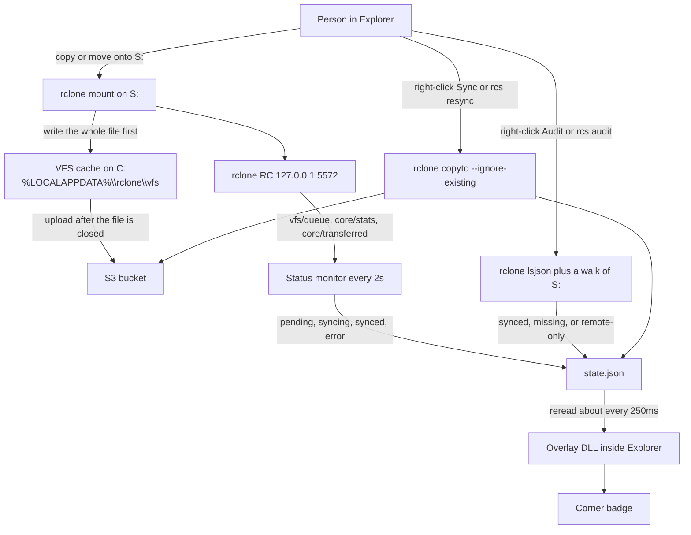
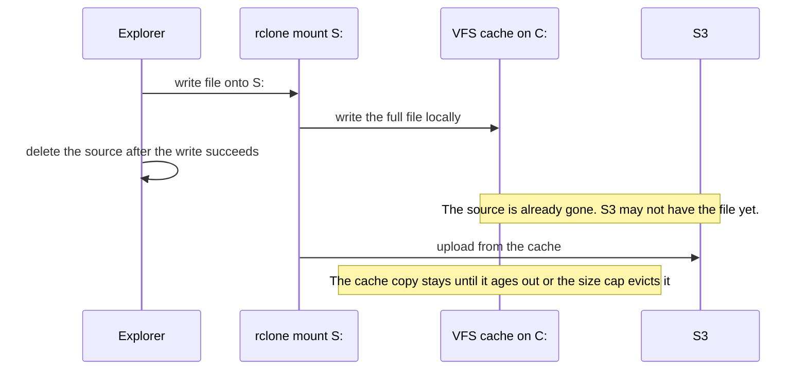
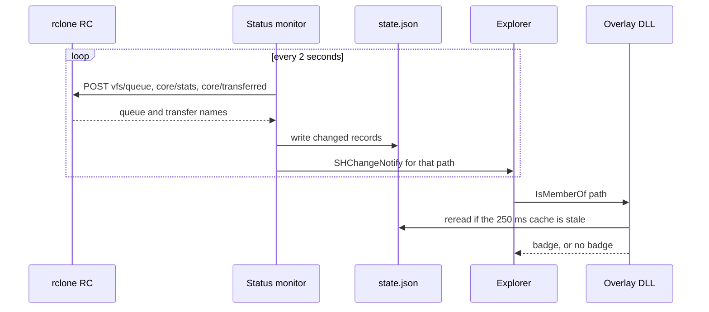

# How Rclone Explorer Status actually works

Windows Explorer is the window. rclone is the sync engine. This program does not talk to S3, and it does not store AWS credentials. It watches rclone, writes a small status file, and lets Explorer paint a corner badge on each file.

That split is the whole design. It is also why a copy onto `S:` can fill `C:` even though the destination looks like a different drive.

## The pieces

| Piece | What it is | What it is allowed to do |
| --- | --- | --- |
| Explorer | The UI people click in | Show folders, start a copy, ask the overlay DLL which badge to draw |
| rclone mount | `S:` pointed at `s3:local-sync-folder-reclone` | Present the bucket as a drive, cache bytes on `C:`, upload to S3 |
| rclone RC | HTTP on `127.0.0.1:5572` only | Answer "what is uploading right now?" |
| Status monitor | `rclone-explorer-status-monitor.exe` | Poll RC every 2 seconds and update `state.json` |
| Overlay DLL | In-process COM handler inside Explorer | Read `state.json` and return a badge |
| `rcs` / shell helper | Commands and the right-click menu | Ask rclone to compare or upload, then update the same status file |

The current mount, started by `scripts/restart-rclone-rc.ps1`, is:

```powershell
rclone mount s3:local-sync-folder-reclone S: `
  --vfs-cache-mode full `
  --vfs-cache-max-size 20G `
  --s3-chunk-size 64M `
  --links `
  --rc --rc-addr 127.0.0.1:5572 --rc-no-auth
```

`--vfs-cache-mode full` is what makes Explorer copies work. It is also what writes every pasted file onto `C:` first. The 20 GB cap and the 64 MB S3 part size were added after a large paste filled the disk and a multi-part upload of a file above roughly 48 GB could not be assembled with rclone's default 5 MB parts.

## One diagram of the whole path



## What a copy onto S: really does

`S:` is not a second disk. It is a WinFsp mount of an S3 bucket. Explorer still treats `S:` as a different volume from `C:`, so a move is a copy followed by a delete of the original. The delete happens only after Explorer believes the copy succeeded.

With `--vfs-cache-mode full`, rclone accepts that copy by writing the entire file into the local VFS cache:

`C:\Users\Admin\AppData\Local\rclone\vfs`

Only after the file is closed does rclone upload that cache file to S3. Until the upload finishes, the cache file is the only complete copy if Explorer has already deleted the source. Opening or browsing files on `S:` downloads them into the same cache. Nothing in the original mount command told rclone to stop at a fixed size, so the cache grew until `C:` had about 3 GB free and the next large paste died with Windows error `0x8007045D` (I/O device error).



A 70 GB file needs about 70 GB free on `C:` to pass through this mount, even though the destination looks like `S:`. If the source is also on `C:`, the peak is the original plus the cache copy. When free space is only about the size of the file, Explorer cannot do it.

The mount-free alternative reads the source once and streams it to the bucket. No second full copy is written on `C:`:

```powershell
rclone copyto "D:\path\file.bin" "s3:local-sync-folder-reclone/folder/file.bin" --s3-chunk-size 64M
```

`--vfs-cache-max-size 20G` makes rclone drop old cached files instead of filling `C:` during ordinary browsing. A file that is still uploading is not evicted. A file larger than the cap still cannot be pasted through Explorer, because full mode has to hold the whole file in the cache while it is open.

## How a badge gets onto an icon

The monitor does not push icons. It writes records. Explorer pulls them.

Every 2 seconds the monitor POSTs an empty JSON body to three loopback endpoints:

| RC call | Meaning in this app |
| --- | --- |
| `vfs/queue` | Waiting in the VFS writeback queue. Not uploading yet becomes `pending`. `uploading: true` becomes `syncing`. |
| `core/stats` | The `transferring` list. Those paths become `syncing`. |
| `core/transferred` | A finished transfer since this monitor process started. An empty error becomes `synced`. A non-empty error becomes `error`. |

Paths are joined onto the configured mount (`S:\`) and stored in lowercase. The monitor skips a write when the state and error text did not change. Finished transfers are remembered for the life of the process, and transfers timestamped before the process started are ignored. Restarting the monitor does not replay old completions.

The record lives in `%LOCALAPPDATA%\RcloneExplorerStatus\state.json`. Saves go to `state.json.tmp` and then replace the real file. If the JSON cannot be parsed, the broken file is renamed to `state.json.corrupt.<unix time>` and the store starts empty.

Explorer loads three overlay handlers from one DLL: error, syncing, and synced. Their registry names begin with spaces so they sort early. Windows only loads the first overlay handlers it finds, and other sync clients compete for those slots. About every 250 ms the DLL rereads `state.json` and searches for the quoted path. `IsMemberOf` returns success only when that object's `"state"` string is exactly `error`, `syncing`, or `synced`.

On each change the monitor calls `SHChangeNotify` for that path so Explorer asks again.



The states the store understands are `unknown`, `pending`, `syncing`, `synced`, `error`, `conflict`, `offline`, and `cloud_only`. The badge map is narrower:

| Stored state | Badge |
| --- | --- |
| `synced` | Green check |
| `syncing` | Blue arrows |
| `error` | Red X |
| `pending`, `conflict`, `offline`, `cloud_only`, `unknown` | No badge |

`pending` is a real monitor state, but the DLL looks for the literal string `syncing`, so a file that is only queued does not get the blue arrows until rclone reports it as uploading. The same gap exists for `conflict`. A Go helper maps `pending` to the syncing badge and `conflict` to the error badge, but Explorer does not use that helper. It uses the DLL.

If RC is down, the monitor logs that automatic updates are paused and keeps polling. It does not mark files offline by itself. When RC returns, it logs that updates resumed. `rcs doctor` and the Start Menu window both check this same port.

## Audit, remaining, and resync

Live badges only describe transfers rclone is doing right now. They do not say whether every file on `S:` exists in the bucket. Audit is the comparison that does.

`rcs audit "S:/courses"`, or the folder right-click **Audit folder with Rclone Explorer Status**, does two listings and nothing else:

1. Walk `S:\courses` through the mount and collect file names.
2. Run `rclone lsjson --recursive --files-only` on `s3:local-sync-folder-reclone/courses`.

Names are compared case-insensitively. Size and checksum are not compared.

| On the mount | On the remote | Record written | Badge |
| --- | --- | --- | --- |
| yes | yes | `synced` | Green check |
| yes | no | `error`, message `object missing on remote` | Red X |
| no | yes | `cloud_only` | None. The record is not written for a path Explorer is not showing as a local file. |

`rcs remaining` prints the local-only set: folders with counts, and files if `--items` is passed. It does not change badges.

`rcs resync` and the file right-click **Sync with Rclone Explorer Status** upload through rclone, still not through an AWS SDK. A single file uses `rclone copyto --ignore-existing` and refuses if that name is already on the remote. A folder audit's local-only files and uploads each one the same way, then audits again so the badges match. The shell helper first paints the file as `syncing`, then `synced` or `error`. One file is allowed two hours. A folder audit is allowed 30 minutes. Resync of a folder is allowed two hours.

`rcs set "S:\path\file.txt" synced` writes a badge by hand. The only accepted values are `synced`, `syncing`, and `error`, and the path has to be on the configured mount.

## What is working today

- `S:` is an rclone mount of `s3:local-sync-folder-reclone` with full VFS cache, a 20 GB cache cap, 64 MB S3 parts, symlink support, and RC bound to loopback without auth.
- The background monitor polls RC every 2 seconds and updates `state.json` for files that appear in the queue or in the transfer lists.
- Explorer shows three badges: synced, syncing, and error. The handler rereads the status file about four times a second.
- Right-click Sync uploads one missing file. Right-click Audit compares one folder. Both go through rclone.
- `rcs status`, `doctor`, `remaining`, `audit`, `resync`, `logs`, and `set` are the command-line equivalents. `doctor` checks that rclone is on PATH and that RC answers.
- The Start Menu app shows mount, remote, whether RC is reachable, and counts of synced, syncing, and error records.
- Config lives in `%APPDATA%\RcloneExplorerStatus\config.json`. State and logs live under `%LOCALAPPDATA%\RcloneExplorerStatus\`. Uninstall removes the handlers and binaries and leaves config, state, and logs in place.

## Limits, including the ones that already showed up

**The mount fills `C:`.** Every byte written to `S:`, and every byte read back from it, can land in the VFS cache on `C:`. A paste is not a direct S3 upload. With only about as much free space as the file is large, the copy fails halfway and Windows reports an I/O device error. The 20 GB cap limits idle cache. It does not make a 70 GB Explorer paste possible.

**A move can delete the original before S3 has the file.** Explorer deletes the source when the write to `S:` returns. That write returns when the cache copy is done, not when the upload is done. Shutting the mount down, or running out of disk, in that window leaves the file only in the cache.

**Large files need a direct rclone or AWS CLI copy.** Streaming from the real source path does not allocate a second full copy on `C:`. The AWS CLI still uploads. It just does not go through the mount. Do not run that at the same time as the mount's own upload of the same key.

**S3 part size matters above about 48 GB.** A multipart upload allows 10,000 parts. The default 5 MB part size tops out near 48 GB. The mount now uses 64 MB parts so a larger object can be assembled. A one-off `rclone copyto` or `aws s3 cp` of a file that size needs the same kind of part size.

**Badges are not a checksum.** Audit compares names. A file can be `synced` and still differ in size or content. A queued file stored as `pending` gets no badge. `cloud_only` gets no badge. Transfers that finished before the monitor started are invisible until the next audit.

**RC is required and local.** Without `--rc --rc-addr 127.0.0.1:5572`, the monitor pauses. The port has no authentication, so it must stay on loopback. A mount started without those flags looks like a normal `S:` drive and produces no live badges.

**Explorer only loads a handful of overlay handlers.** The names are padded with spaces so they sort near the front. OneDrive, Dropbox, and similar tools can still crowd them out. After install, Explorer has to be restarted before the badges appear.

**The DLL's JSON reader is a text search.** It looks for the quoted path and then a `"state"` field inside the next object. That matches the file this program writes. It is not a general JSON parser.

**Audit walks the mount.** Listing `S:\` is a listing through rclone. On a large bucket that walk is slow, and it is not a listing of the cache directory. A dirty cache file that the mount is showing, and that `lsjson` does not yet see, is reported as missing on the remote.

**Resync will not replace an object that is already there.** `--ignore-existing` plus the single-file "already exists" check are deliberate. Updating a changed file is a different operation from "upload what the bucket does not have."

**The transition table is documentation, not a gate.** `IsValidTransition` describes a legal sequence from `unknown` through `pending` and `syncing` to `synced` or `error`. `Set` does not enforce it. Audit can jump a file straight to `synced` or `error`.

## What this program will not do

It will not open an AWS SDK, read `rclone.conf`, or hold an access key. Upload, list, and compare are rclone subprocesses or RC calls. If the mount is down, RC calls fail and the badges freeze on the last `state.json`. If the cache is deleted while a file is dirty, that file is gone even though Explorer recently showed it on `S:`.
